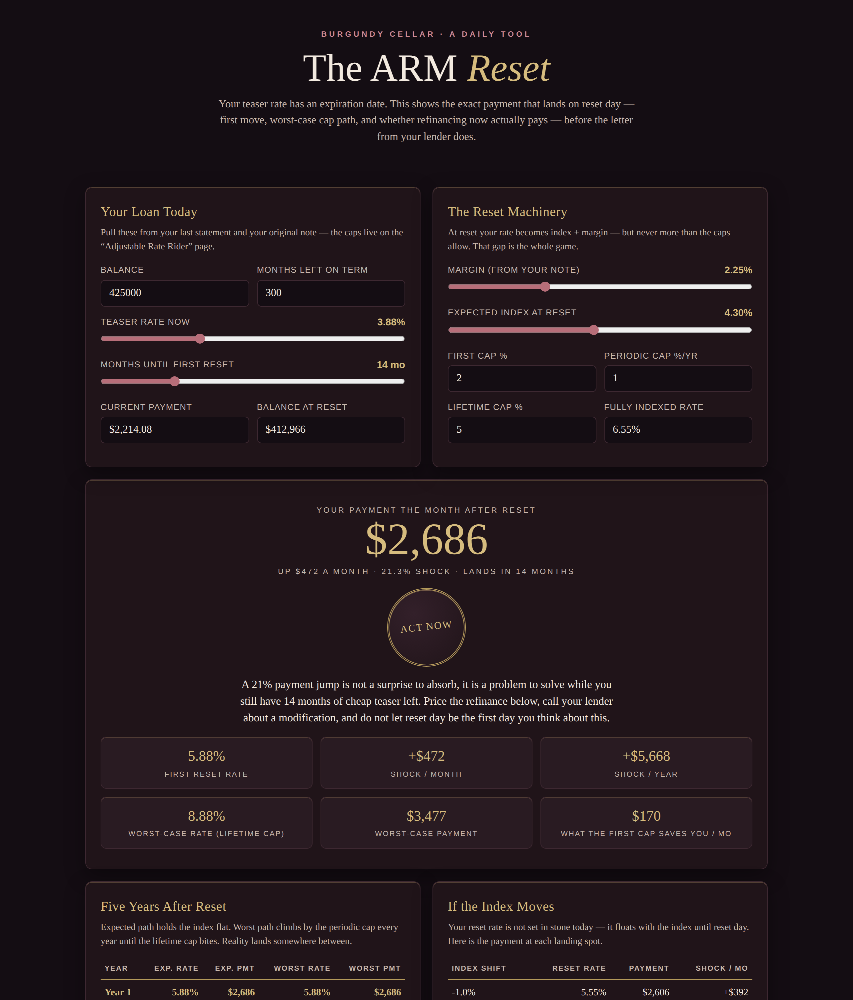

# The ARM Reset

**Live:** https://thebullbrew.github.io/arm-reset/
**Repo:** https://github.com/thebullbrew/arm-reset

## What it does

Your teaser rate has an expiration date. The ARM Reset shows the exact payment that lands on reset day — before the letter from your lender does.

- **First reset rate, done right:** index + margin, clamped by your first-adjustment cap and lifetime cap, priced on the actual balance and term remaining at reset — not today's balance.
- **The shock, in plain numbers:** dollars per month, dollars per year, and percent, with an ABSORB IT / PLAN FOR IT / ACT NOW verdict.
- **What the cap saves you:** the difference between your capped first payment and the uncapped fully-indexed payment.
- **Five-year path:** expected payments (index flat) vs the worst case, where the rate climbs by the periodic cap every year until the lifetime cap bites — and the total five-year gap between them.
- **Index sensitivity:** reset payment at index shifts from −1% to +2%, so you know which landing spots hurt.
- **Honest refinance math:** refinancing out of a cheap teaser means paying *more now* to pay *less later* — the tool counts closing costs plus the teaser-period overpay to give a true break-even in months after reset, with a REFI WINS / CLOSE CALL / SKIP IT call.
- Save scenarios per property in your browser, and copy a plain-text summary.

## The method

An ARM reset is not index + margin — it is index + margin *as limited by the cap structure in your Adjustable Rate Rider*. Most calculators skip the caps, skip the amortized balance at reset, and price a refinance break-even as if the teaser were free. This one does none of that: real amortization to the reset date, capped first rate, an annual worst-case climb, and a refinance break-even that charges you for every extra dollar paid while the teaser was still cheap.

## Who it's for

Homeowners and investors holding 5/6, 7/6, or 10/6 ARMs from the cheap-money years — the big 2021–2022 vintages are resetting now. Fifteen minutes with your note's caps page beats one surprised phone call.

## How to run

Open `docs/index.html` in any browser, or visit the live link above. No backend, no accounts, no data leaves the device. Installable as a PWA and works offline after first load.

Design: dark old-money variation 6 — Burgundy Cellar (wine-dark surfaces, rose-gold interactive elements, gold display numbers, soft inner-glow card tops).
